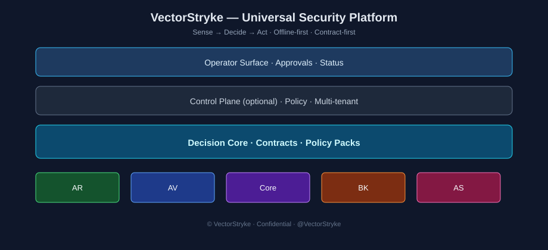

# VectorStryke Security Platform

**Version: 1.0.0** — see `VERSION` and `release/v1.0.0/`

## VectorStryke — in simple terms

**VectorStryke** is a security software platform meant to protect computers, servers, and related systems from cyber attacks — especially ransomware, malware, and email threats — and to help recover if something goes wrong.

Think of it as a **toolkit of security products that work together**, not one single app.

### What it does

| Piece | Plain meaning |
|-------|----------------|
| **AR** (Anti-Ransomware) | Watches the machine for ransomware-like behavior and can stop/quarantine threats |
| **AV** (Antivirus) | Scans files for known or suspicious malware |
| **BK** (Backup) | Makes safe copies of data, and tries not to back up already-quarantined junk |
| **AS** (Anti-Spam) | Filters bad or dangerous email before it reaches people |
| **Core** | Shared detection engine used for deeper scanning |
| **Platform** | The brain and rulebook — shared policies and decision logic so modules stay consistent |

### How it decides what to do

1. **Sense** — notice something (odd file, process, email, login)
2. **Decide** — score it against rules/policies
3. **Act** — quarantine, block, alert, or restore

It is designed to work **even offline**, so protection does not fully depend on the cloud.

### Who it is for

- Companies protecting many desktops and servers
- Teams that need Windows and Linux (and some macOS/Unix support)
- Developers building and improving the product from the GitHub code

### One-line summary

**VectorStryke is a modular security system that detects threats, decides what to do, and acts to contain or recover — across ransomware, malware, backup, and email — using shared rules so everything stays aligned.**

---

## Start here (developers)

1. `release/v1.0.0/README.md` — install & smoke
2. `release/v1.0.0/PRODUCTION_READINESS.md` — what is production-ready
3. `platform/docs/onboarding/Developer_Onboarding_Guide.md` — Git / CI / Agile

## Layout

| Path | Role |
|------|------|
| `platform/` | Contracts, Decision Core, phases 4–11 |
| `AR/` `AV/` `BK/` `Core/` `AS/` | Product modules |
| `release/v1.0.0/` | Production packaging |

© VectorStryke
